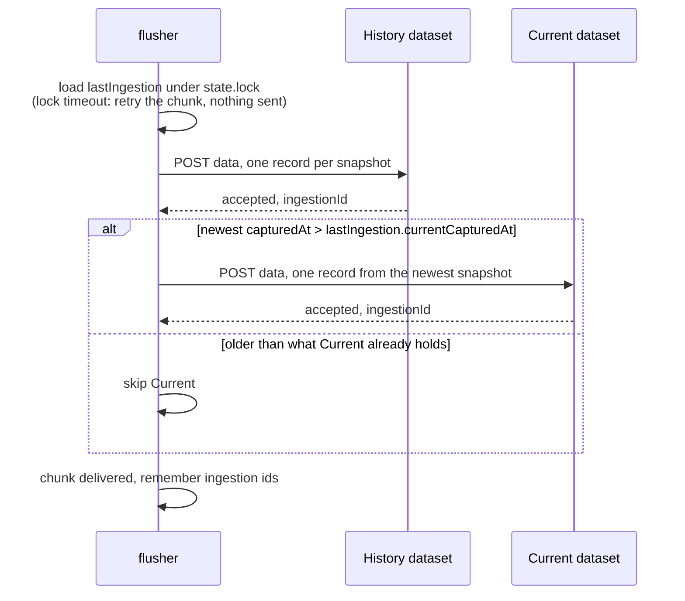
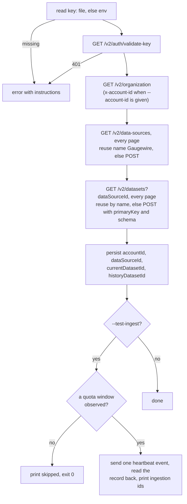

# Databox sink

Status: Draft · Partial · 2026-10-23 · The first sink: Databox REST API v2, two datasets, batching and ordering, acknowledgement, error classes and bootstrap.

Changes: [2026-10-23-databox-sink-targets-v2.md](../../adr/2026-10-23-databox-sink-targets-v2.md)

## At a glance

The sink writes every event to a History dataset keyed by `event_id` and the newest event of a
batch to a Current dataset keyed by `account_id`. Both keys upsert, so any resend is safe. The
API accepts ingestion asynchronously; an accepted request is the acknowledgement, and `doctor`
polls the latest ingestion to surface a failure. Everything the sink knows about the API comes
from the public developer documentation; the behaviours it does not document are recorded as
assumptions. The code is built; the acceptance test on a real machine, which settles those
assumptions, is outstanding.

## API facts (public documentation)

Source: the public developer documentation at https://developers.databox.com/docs/api, fetched
2026-10-23, including the v1 to v2 migration guide. v1 still runs; new functionality goes to v2
only.

- Base `https://api.databox.com/v2`, header `x-api-key`, JSON request and response bodies, every
  response carries `requestId`.
- Success responses carry `{requestId, status, data}`; lists carry
  `data: {items, pagination: {page, pageSize, totalItems}}`, with `page` 0-indexed and
  `pageSize` at most 100.
- Requests act on the key's organization. The optional header `x-account-id` acts on one of the
  organization's accounts instead; data sources, datasets and the organization resource accept
  it, and key validation ignores it.
- `GET /v2/auth/validate-key`: 200 when the key is valid, 401 when it is missing or invalid.
- `GET /v2/organization` → `data: {id int, name, ...}`.
- `GET /v2/data-sources` (paginated) → items `{id int, name, integrationKey, timezone, ...}`.
- `POST /v2/data-sources` body `{name (required), timezone}` → `data: {id int, name, ...}`.
- `GET /v2/datasets?dataSourceId={id}` (paginated) → items
  `{id int, dataSourceId int, name, ingestionSupported, ...}`.
- `POST /v2/datasets` body `{name, dataSourceId int, primaryKey []string, schema: [{id,
  dataType}]}`; `name`, `dataSourceId` and `schema` are required and `dataType` is `datetime`,
  `number` or `string` → `data: {id int, name, ...}`.
- `POST /v2/datasets/{id}/data` body `{records:[{...}]}` →
  `data: {ingestionId, status, message}`.
- `GET /v2/datasets/{id}/ingestions/{ingestionId}` → `data: {id, initiatedAt, status, duration,
  summary: {ingestion: {receivedRecordCount, appendedRecordCount, overwrittenRecordCount,
  rejectedRecordCount}, dataset: {...}}, errors: [{code, message, field, record}]}`.
  Overwritten means a record with an existing primary key replaced the stored row.
- Error envelope `{requestId, status:"error", errors:[{code, message, field, type}]}`. Documented
  statuses: 400, 401, 403, 404, 413, 429 and 500. Error codes can also arrive in the body of a
  2xx response.
- Rate limits: 10 000 requests per hour and 10 per second per key; backoff is expected. Payloads
  are at most 500 rows or 10 MB per request.
- POST requests accept an optional `Idempotency-Key` header; the sink does not send it, because
  both datasets upsert by primary key.

## Assumptions to verify

- Whether datasets created through v1 appear in the v2 lists. Bootstrap reuses them by name if
  they do, and creates two new, empty datasets if they do not.
- Whether a throttling 429 carries the JSON envelope. The classifier does not depend on it.
- What `status` values an accepted ingestion reports. The sink acknowledges on `ingestionId`
  alone.

## Datasets

One data source named `Gaugewire`, timezone `UTC`, with two datasets.

**Claude Quota History**, primary key `event_id`, one row per event:
`event_id, event_type, account_id, account_alias, node_id, node_alias, platform, captured_at,
published_at, five_hour_status, five_hour_used_percentage, five_hour_resets_at,
seven_day_status, seven_day_used_percentage, seven_day_resets_at, source_type,
claude_code_version, observer_version`.

**Claude Quota Current**, primary key `account_id`, one row per subscription:
`account_id, account_alias, node_id, node_alias, platform, latest_event_id, captured_at,
last_seen_at, five_hour_status, five_hour_used_percentage, five_hour_resets_at,
seven_day_status, seven_day_used_percentage, seven_day_resets_at, claude_code_version,
observer_version`.

One row per subscription holds when every machine on the subscription shares its account id
(`install --account-id`). Across machines the last writer wins, because each machine's
`currentCapturedAt` guard knows only its own deliveries; History keeps every event.

Every column is present in every record, `null` when unknown. Timestamps are RFC 3339 UTC with
millisecond precision; percentages are JSON numbers. `published_at` and `last_seen_at` are set
by the flusher at send time. Bootstrap declares every column when it creates a dataset: `*_at`
columns as `datetime`, `*_used_percentage` as `number`, and everything else as `string`.

## Delivery of one chunk

The flusher hands the sink one `Delivery` per event — its event type and the snapshot, nothing
else. History first, then Current. Both accepted is success. Otherwise the whole chunk is
retried or dead-lettered; the primary keys make resending safe. Chunks are chronological,
Current gets the newest snapshot of the chunk, and the `currentCapturedAt` guard keeps a
requeued old event from overwriting newer state: Current is skipped whenever the newest
snapshot's `capturedAt` is not strictly after what is already recorded, so an equal capture time
is skipped too. `published_at` (History) and `last_seen_at` (Current) are the send time, not the
snapshot's `capturedAt`.

Before posting anything, the sink loads its ingestion record from `state.json` under
`state.lock`, since the guard needs it. A load that fails — the lock wait ran out, the file could
not be read — fails the chunk as retryable before any request; nothing is lost, because a retry
resends History, which is an upsert. A corrupt `state.json` is logged and read as no record, so
Current is sent. Once History has accepted the chunk — and Current too, when the guard sent it a
request — the sink saves its ingestion record (the two ingestion ids and the `capturedAt` Current
now holds) in `state.json` under `state.lock`. A failure to save is logged and never retried, because the
API already accepted the data; the chunk is not failed for it. A lost save (the `state.lock`
wait timed out) leaves the previous record in place, so the `currentCapturedAt` guard is
bypassed on every following chunk until a newer event's save succeeds and corrects Current.

## Acknowledgement

An HTTP 200 with an `ingestionId` is the ack; the event is deleted. Asynchronous processing
failures are surfaced by `doctor`, which polls the latest ingestion id per dataset and judges it
by `summary.ingestion.rejectedRecordCount`, never by `status`; when records were rejected, the
row also shows the first entry of the ingestion's `errors`. The stricter verify-before-ack mode
is in the nice-to-have ledger. Decisions:
[acknowledge on accept](../../adr/2026-09-17-databox-sink-targets-v1-and-acks-on-accept.md),
amended by
[judge ingestions by rejected records](../../adr/2026-09-19-doctor-judges-ingestions-by-rejected-records.md),
both amended by [target v2](../../adr/2026-10-23-databox-sink-targets-v2.md).

## Error classes

The flusher's classes are in [spool-and-flush](spool-and-flush.md#error-classes); the client
maps the API onto them:

- An error status decides the class; the error envelope's first `code` names it, else
  `invalid_api_key` (401), `forbidden` (403), `not_found` (404), `timeout` (408),
  `request_too_large` (413), `rate_limited` (429), `server_error` (5xx) or `invalid_request`
  (other 4xx).
- A 2xx whose body says `"status":"error"` is classed by its first `code`: `rate_limited`,
  `internal_error`, `service_unavailable` and `processing_failed` are retryable, any other code
  is permanent, and no code at all is retryable `invalid_response`.
- A 2xx whose body or `data` does not decode, or an ingestion response without `ingestionId`,
  is retryable `invalid_response`; key validation, which reads no payload, ignores its body.
- A list is read page by page, 100 items a page, until `totalItems` is reached or, without it,
  until a page comes back short. A list still going after 100 pages is retryable
  `invalid_response`.
- A redirect is never followed and is permanent `redirect`.
- More than 100 records in one ingestion is permanent `too_many_records`, before any request.
- A base URL that is not `https`, other than plain `http` to `localhost` or a loopback address,
  is refused when the client is built, so the sink is not built and the flush fails.

## Credentials

`apiKeyFile` (`0600`, recommended for fleet machines whose Claude sessions start without a
shell profile) or the environment variable named by `apiKeyEnv`. A key file readable by others
is still used, with a warning, rather than refused; `doctor`'s sink auth row shows the warning
next to `key valid`. A key file that does not exist is reported without its path, since a key
pasted where the path belongs would otherwise be printed back. The key is never logged, never
stored in config, state or events. It travels over https only — plain http is accepted to this
machine alone, for tests — and redirects are refused as permanent errors, so the `x-api-key`
header never crosses the network in clear and is never replayed to another host.

## Bootstrap

`gaugewire databox bootstrap [--account-id n] [--api-key-file path] [--base-url url]
[--sink-id id] [--test-ingest]` prints one line per resource as it resolves: `organization:`,
`data source:`, `history dataset:` and `current dataset:` (each `created` or `reused`), and,
with `--test-ingest`, `test ingest:` with both ingestion ids, or why it was skipped.

Every run re-resolves the data source and the two datasets by name against the organization's
current lists — an id already in config.json is never trusted, only overwritten — so a name
match is reused and only a missing one is created; repeated runs create nothing new. A dataset
id left by a v1 `config.json` is a UUID string; it reads as unset, so the sink refuses to build
and its events stay spooled until bootstrap writes the integer ids. When either dataset id
changes, bootstrap also resets the sink's ingestion record in `state.json`, since its ingestion
ids and `currentCapturedAt` belong to the datasets it replaces. `doctor` reports a sink with
both dataset ids unset as `dataset ids not configured; run gaugewire databox bootstrap`.
`--base-url` defaults to the public host and overwrites a configured `baseUrl` on every run; the
flag exists so a test can point bootstrap at `httptest`, not to repoint a fleet machine at a
different real host. `--account-id` acts on one account of the key's organization: it is sent
as `x-account-id` on every request, bootstrap's and the sink's, and is saved as `accountId` on
every run, so a run without it acts on the organization itself. With two data sources sharing a
name, the first one the API lists wins.

`--test-ingest` sends one heartbeat snapshot after bootstrapping, but only once `state.json`
holds an observed quota window: before Claude Code has shown its status line the heartbeat would
carry nothing but nulls, so the command prints `test ingest:      skipped: no quota observation
yet; run it again after Claude Code has shown its status line` and succeeds without a request.
It fails if the ingestion record read back from `state.json` after the API accepted the
heartbeat is missing or does not carry this send's time, since an unrecorded ingestion, or a
record an earlier run left behind, would otherwise look like a working sink. So run bootstrap
at setup, and `gaugewire databox bootstrap --test-ingest` again after the first observation;
bootstrap is idempotent, so the second run creates nothing. A key-file permission warning
from bootstrap goes to stderr.

## Open questions

- The assumptions above.
